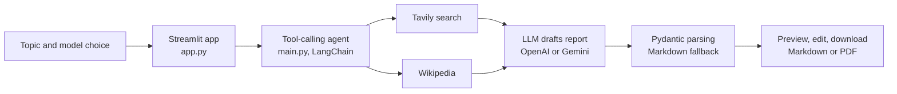

# AI-Agent-for-research

A Streamlit web app that takes a topic and writes a structured research report, with a hosted demo at https://ai-agent-for-research.onrender.com.

The app runs on LangChain, a Python framework for building LLM applications. The demo sits on Render, a hosting service, and may take up to a minute to wake up on first visit.

## Problem and approach

Writing a first-draft report on an unfamiliar topic means searching, reading and formatting. This app hands the search and drafting to a tool-calling agent and leaves review to you.

1. You pick a model (OpenAI GPT-4o-mini or a Google Gemini model) and enter a topic.
2. A LangChain agent (`main.py`) calls tools: Tavily web search (a search API built for LLMs), Wikipedia lookup and a save-to-file tool.
3. The model returns a report with an abstract, introduction, analysis and conclusion. Pydantic (a Python validation library) parses it into a fixed structure, with a fallback to plain Markdown if the model returns malformed output.
4. You preview the report, edit it in the page, and download it as Markdown or PDF.
5. `config.py` caps use at 4 requests per session to limit API cost.

## Architecture



## Results

This repo has no measured results. It demonstrates an agent loop with tools, structured output with a fallback, session rate limiting and an editable report view. I have not measured report accuracy or cost per report. The `tests/` folder has pytest files for output parsing and utility functions. Example reports are in `outputs/`.

## Run it

You need Python 3.10 or newer and an API key for the model provider you choose, plus a Tavily key for search.

```powershell
git clone https://github.com/unusual9guy/AI-Agent-for-research.git
cd AI-Agent-for-research
python -m venv .venv
.venv\Scripts\Activate.ps1
pip install -r requirements.txt
# create a .env file with the variables below, then:
streamlit run app.py
```

PDF export is optional and uses `reportlab` or `weasyprint` when installed (`pip install reportlab`). Without them the app offers Markdown only.

| Variable | Purpose |
|---|---|
| `OPENAI_API_KEY` | Needed for the OpenAI model option |
| `GOOGLE_API_KEY` | Needed for the Gemini model options |
| `TAVILY_API_KEY` | Web search |

You only need the key for the provider you use, plus the Tavily key.

## Limitations and next steps

- Reports are only as good as the sources the search tools return, and nothing checks claims against them. Read them as drafts.
- The hosted demo runs on a free tier, so the first request can be slow.
- The 4-request session limit is a cost guard, not a quota system.
- The generated reports in `outputs/` are examples and are not fact-checked.

## Screenshot

TODO: add a screenshot or GIF of the app.
